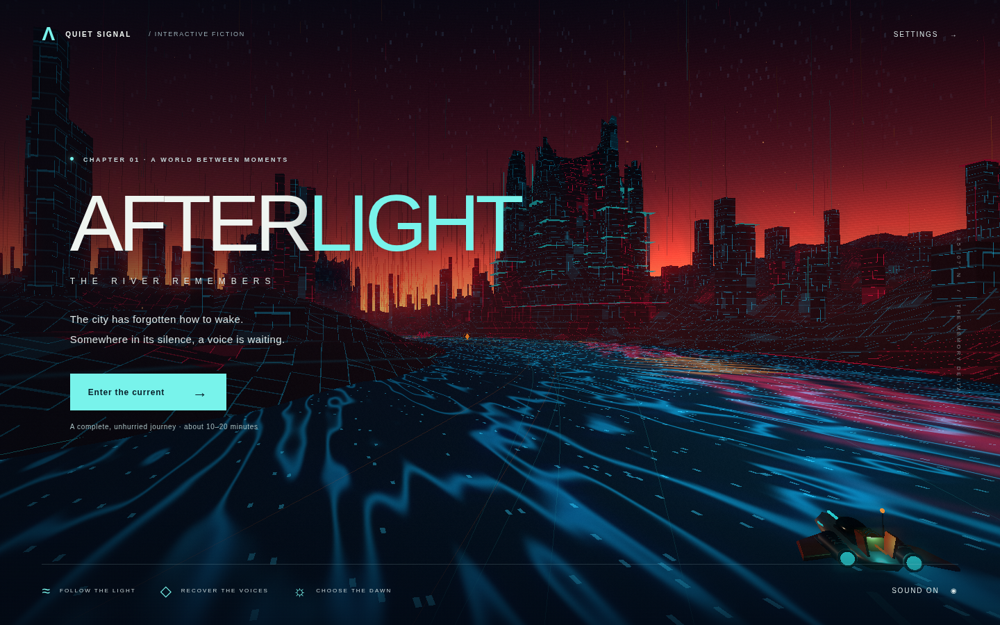

# AFTERLIGHT — The River Remembers

A complete atmospheric 3D chapter inspired by the supplied neon landscape. Pilot a salvage skiff through a fractured city, recover three voices, and choose the dawn. Designed for an unhurried 10–20 minute visit; optional memories and stopping to listen determine the pace. There is a beginning, three relay encounters, a final choice, and two endings. No timer or lives.



## Run and build

Use Node.js 20+ from this folder:

```sh
npm run dev      # http://localhost:5173 — source, with optional development hooks
npm run build    # rebuild the committed dist/ folder
npm run preview  # http://localhost:4173 — production build
npm test         # progression, movement, tuning and save-state checks
```

Building and serving use only Node's standard library; no install is required. Upload the **contents of `dist/`** to any static host, including a subdirectory. Serve over HTTP(S), rather than opening a file URL. No deployment workflow is included.

Three.js is the sole runtime dependency, imported from **jsDelivr at exactly `0.180.0`**. Its `three.module.js` imports the matching `three.core.js`. These CDN module loads are the only external requests. Gameplay, synthesized audio, settings, and saves are local; no accounts, APIs, telemetry, or downloaded art. Modern WebGL 2 is required.

## Controls

| Action | Keyboard / mouse | Standard gamepad |
|---|---|---|
| Thrust / brake | W / S or ↑ / ↓ | Left stick up / down; RT / LT |
| Steer | A / D or ← / → | Left stick |
| Surge | Hold Space or Shift | Hold A |
| Clear nearby pink static | Q | Y |
| Dock / listen / collect | E or click prompt | X |
| Look / reset view | Drag mouse / C | Right stick |
| Pause | Escape | Start |
| Journal / mute | J / M | Pause menu |
| Recover to last relay | R or pause menu | Pause menu |
| Tune relay | ± buttons, sliders; 1–3 select, ← / → turn | Bumpers select; D-pad turns; A receives |

Touch shows a movement stick, surge and pulse buttons; drag the scene to look and tap the docking prompt. The current carries the skiff slowly when idle. Relays save checkpoints and open the next stretch. Match all three cyan waveforms to the pale references. Gold fragments are optional journal memories. Static drains the surge cell; a nearby pulse clears it and restores charge. Recovery keeps discoveries.

Settings offer Performance, Balanced and High presets, sound, and reduced motion. Escape, focus loss and tab hiding hold the current. Progress and settings persist in browser local storage; cleared site data removes them. Starting a new voyage asks before replacing an unfinished save.

## Verification

- Eight logic tests: traversal, surge recharge, bank limits, frame-time clamping, ordered relays, recovery, both endings, save validation and cyclic tuning.
- Chromium browser playthrough: real keyboard movement, pause, settings, a memory, all three tuning interfaces, journal, checkpoint recovery, reload/resume, both final choices and their ending sequences.
- Emulated mobile touch input and 390 × 844 layout; desktop screenshots and shader/error checks. Production checked with `?test=1`: no hook object, and the development module returns 404.
- Remote-request allowlist passed. The headless browser used exact CDN modules downloaded through TLS-verified host requests, because its proxy CA store differs from the host's.
- Static build regenerated and checked. Final screenshots are in `docs/`.

**Not verified:** real integrated-GPU frame rates, physical controllers, real phones, Safari or Firefox, accessibility with a screen reader, or a timed human playthrough. Browser tests use development positioning to cover the chapter; they do not establish its human completion time.

## Art, performance and deliberate shortcuts

Everything is modeled or synthesized in code. Citadels use irregular stepped polygon meshes, broken crowns, buttresses, galleries and light conduits. The skiff has a lofted hull, shaped wings, canopy, salvage rig and engine assemblies. Terrain and large structures use blended **world-space triplanar procedural detail**; the river also shades in world coordinates. There are no stretched image textures.

Static parts are merged by material, repeated structures are instanced, and distant sections are culled. Presets cap render resolution; Performance also skips bloom and ambient motes. Lighting is stylized, with no real-time shadows or reflections. The river guides forward travel; steering is lateral along its bends, rather than unrestricted flight. Three relays share one tuning mechanic. Static is a soft obstacle, rather than a combat system. Dialogue is captioned, with tonal audio rather than recorded voices. These are intentional scope choices for one finished chapter.

Development-only access: run `npm run dev`, open `/?test=1`, then use `window.__AFTERLIGHT.state()` or `.teleport(distance, lateral)`. The build strips the hook import and omits `dev-hooks.js` entirely.

Optional browser tests: `npm ci`, start the dev server, then `npm run test:browser`. Set `CHROMIUM_PATH` if Chromium is not at `/usr/bin/chromium`; set `TEST_URL` for another dev URL. With the production server running, `PRODUCTION_URL=http://localhost:4173 npm run test:browser` also checks production isolation. Playwright is a development dependency only.
