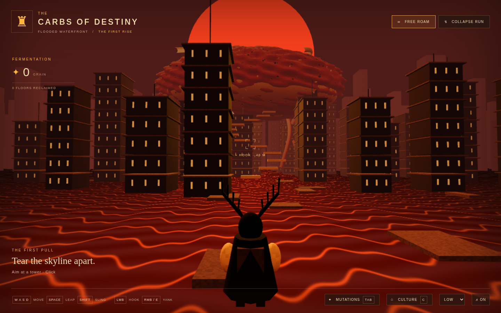
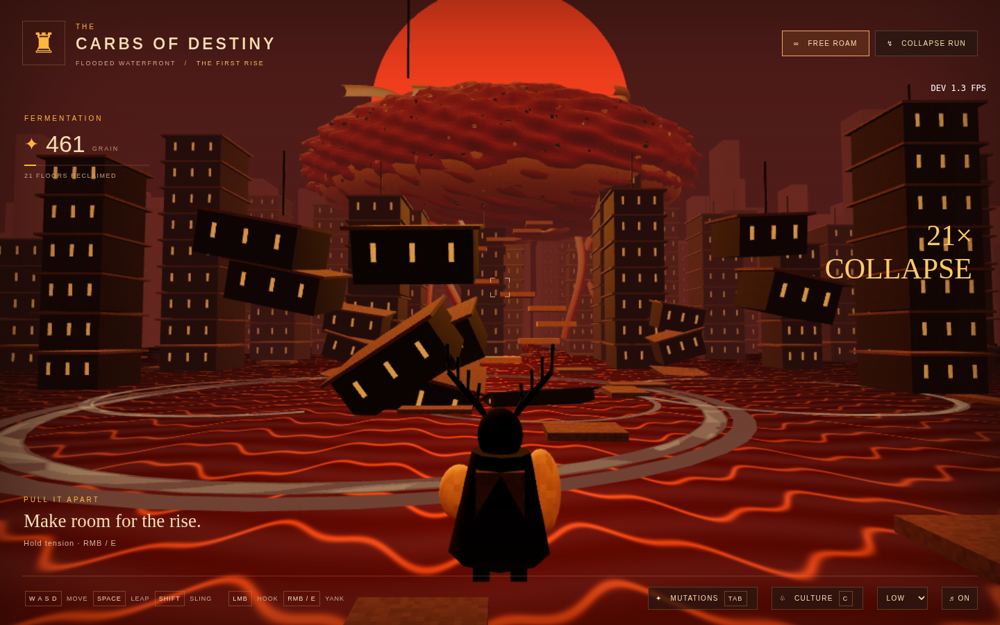
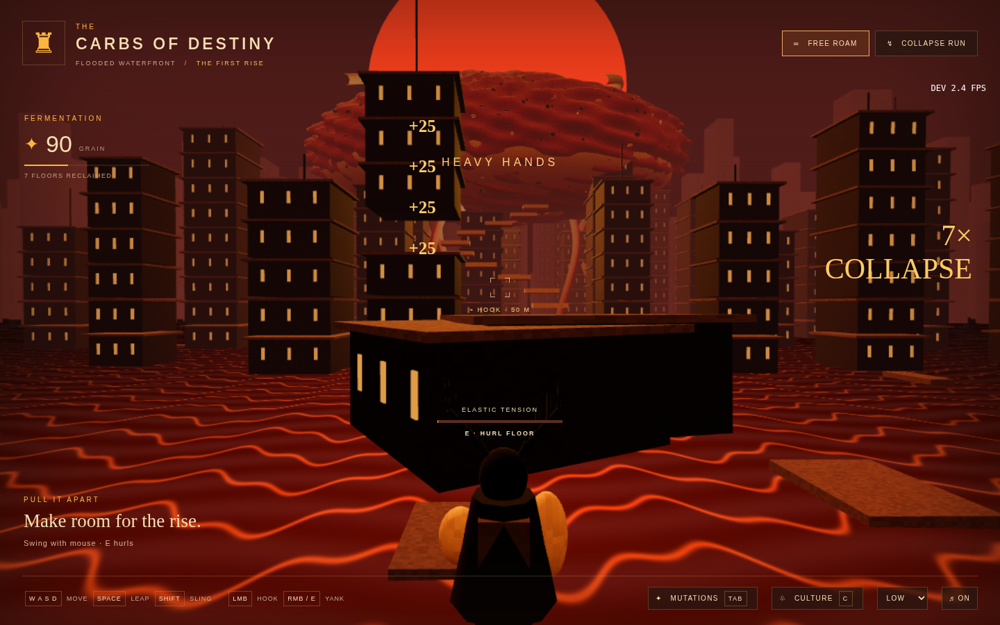
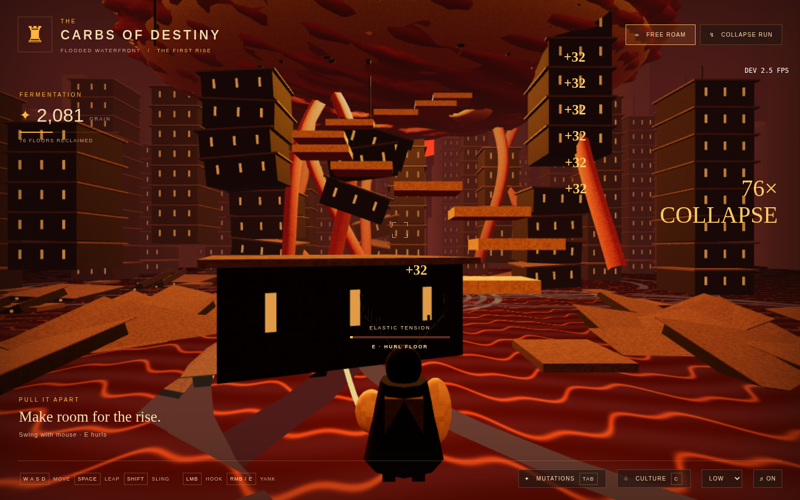

# Browser verification

The automated playthrough runs for at least 180 seconds of wall-clock time in headless Chromium at 1440 × 900, low preset, with software WebGL (SwiftShader). It hooks, tensions and yanks floors, buys a power upgrade with earned grain, and moves deeper into the district. It also enters/exits Collapse Run, reloads the save, and loads the production build to check removal of development state access. This environment has shared CPU resources; its FPS is not a measurement of laptop integrated graphics.

Measured final run: **8.91s** to first hook from scene boot; **1.35 average FPS** on low with software WebGL; **0.33 minimum FPS** including capture stalls. The core loop ran for at least 180 seconds; total verification took 208.2s. **78 floors** were reclaimed and the first power upgrade was purchased using earned grain. **Zero console errors.** Quick-mode entry, save restoration, and stripped production hooks all passed. The 60 FPS laptop target remains unverified and was not achieved in this software-rendered environment.

[Raw report](screenshots/report.json) · [Additional checks](screenshots/checks.json). Full generated test output remains ignored.

Visual comparison with inspiration d397f2e8:

- **0s:** retains the blood-red sun, gigantic warm crust silhouette, dark jagged city, scarlet floodwater and antler-crowned traveler. The camera is closer and landscape-shaped to support movement. Procedural water is more stylized and regular than the source photograph's ripples.
- **30s:** demolished floors open sightlines toward the loaf, with slabs, water rings and grain feedback taking the place of the image's stillness.
- **First upgrade:** the gauntlets enlarge and the HUD records the grain spent; power growth is visible on the player's silhouette.
- **3min:** the camera has moved into the waterfront and the cleared skyline records destruction. The loaf and roots stay fixed as navigation landmarks. This view intentionally differs from the starting composition because it records free movement.

Not verified: real laptop GPU frame rate, sustained 30-minute balance, subjective sound mixing on speakers, touch-only completion, mobile thermal performance, gamepad support, all 24 upgrade combinations, and cross-browser behavior. There is no claim of 60 FPS based on software-rendered headless results.

Additional browser checks passed: upgrade purchase through the UI, keyboard movement, jump, passive colony income, Collapse Run victory, main/quick save isolation, save restoration after reload, and production test-hook removal.

## Captures

| Start / first hook | 30 seconds |
|---|---|
|  |  |

| First mutation | Three minutes |
|---|---|
|  |  |
