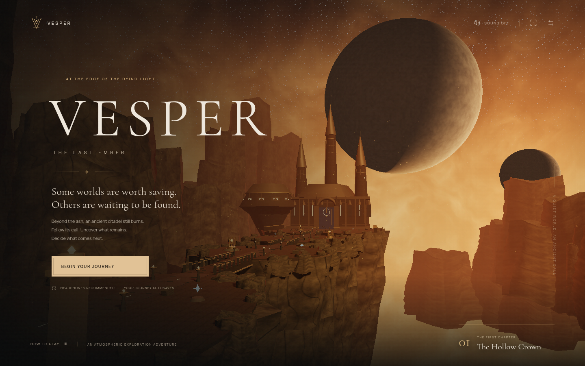

# VESPER — The Last Ember

A playable, self-contained 3D exploration game inspired by a cliffside citadel beneath an eclipsed sky. Built with TypeScript, Three.js, and Vite. The opening chapter has a complete beginning, middle, and two possible endings.



You are a pilgrim carrying the last living ember of a silent star. Cross the skybridges, recover four memories, awaken three resonators, and choose what the next dawn will become.

## Run

Requires Node.js 22.12+ (Node.js 24 is validated).

```sh
npm ci
npm run dev
```

In this cloud workspace, use `npm ci --cache /workspace/.npm-cache` if the default npm cache is not writable. The development server listens on all interfaces at port 5173. No API keys, accounts, backend, or external assets are required at runtime.

```sh
npm run build     # Type-check and produce dist/
npm run preview   # Serve the production build
npm test          # Game-state and route tests
npm run test:browser  # Browser playthrough; run the dev server first
```

The browser suite uses `/usr/bin/chromium` by default. Set `CHROMIUM_PATH` for another installed Chromium executable, and `TEST_URL` if the development server uses another address. The suite runs the whole chapter with development-only positioning hooks; movement, controls, interactions, ring solving, endings, and persistence use the actual UI. Screenshots are saved in `artifacts/`.

## Play

| Action | Keyboard / mouse | Controller |
| --- | --- | --- |
| Move | WASD or arrow keys | Left stick |
| Look | Drag the scene | Right stick |
| Sprint | Hold Shift | Hold LB |
| Jump | Space | A |
| Interact | E or click the interaction prompt | X |
| Ember pulse | Q | Y |
| Pause | Escape | Start |
| Journal | J or pause menu | Pause menu |
| Reset camera | R | — |
| Zoom | Scroll wheel | — |

Touch devices display a movement joystick and action buttons. Drag outside those controls to look. Ring puzzles support touch, mouse, keyboard (1–3 to select; A/D or arrows to turn), and controller (LB/RB to select; D-pad left/right to turn). Controller menus support D-pad navigation, A to select, and B to return.

Walk along the inlaid route. Golden resonators save your checkpoint when awakened. Blue shards hold optional memories. Guardians can be temporarily disabled with an ember pulse. Falling or losing your ember returns you to the last checkpoint without removing discoveries. Once all three resonators are awake, enter the citadel threshold.

Progress and settings are saved in the current browser's local storage. Saves are device/browser-specific. Private browsing or cleared site data may remove progress. Starting a new journey asks before replacing the save.

## Visuals and platform support

The game renders an actual navigable 3D world: procedural rock surfaces and masonry, gothic architecture, shader planets and sky, animated cloth, embers, dynamic light, shadows, and bloom. Its soundscape is synthesized locally with Web Audio. Fonts are bundled. Static geometry is batched to reduce draw calls. High, Balanced, and Performance presets control render resolution, shadows, and bloom. Touch devices default to Performance.

Requires WebGL 2 and a modern browser. Desktop keyboard/mouse, standard gamepads, and mobile touch are implemented. Browser automation validates Chromium desktop and emulated touch; real iOS/Android hardware, Safari, Firefox, and physical controllers still need device testing. This is a polished playable opening chapter, not a full AAA production or a claim of photorealistic final art.

## Structure

- `src/world.ts`: 3D environment, procedural art, character, lighting, particles, camera.
- `src/game.ts`: traversal, checkpoint/save validation, resonator logic, stamina, and combat state.
- `src/main.ts`: input, menus, story, UI, persistence, and game loop.
- `src/audio.ts`: generated ambience and gameplay audio.
- `src/style.css`: responsive interface and bundled typography.
- `tests/`: unit tests and browser playthrough.

The `?test=1` positioning hooks exist only in Vite development mode and are excluded from production builds.

## Publish

`dist/` is a static website. Deploy it to any static host with HTTPS (for example Cloudflare Pages, Netlify, Vercel, or GitHub Pages). There are no server endpoints or paid services. For a subdirectory deployment, build with `npm run build -- --base=/your-path/`; assets and the favicon use that base path.

The included GitHub Pages workflow tests, builds, and deploys each push to `main`. To enable it once, open the repository's **Settings → Pages**, select **GitHub Actions** as the source, then open **Actions → Deploy Vesper to GitHub Pages → Run workflow**. Future pushes deploy automatically. For `kurtholes/codex`, the expected address after a successful deployment is `https://kurtholes.github.io/codex/`. The workflow's deployment result confirms the live URL. Repository Pages availability depends on the account's plan and organization settings.

## Art and scope

World geometry, surface textures, character animation, interface, narrative, and audio are created procedurally/in code for this project. The supplied reference image guides atmosphere and architecture; it is not embedded as a flat substitute for the game world. Open-source dependencies and bundled fonts retain their respective licenses in their packages.
